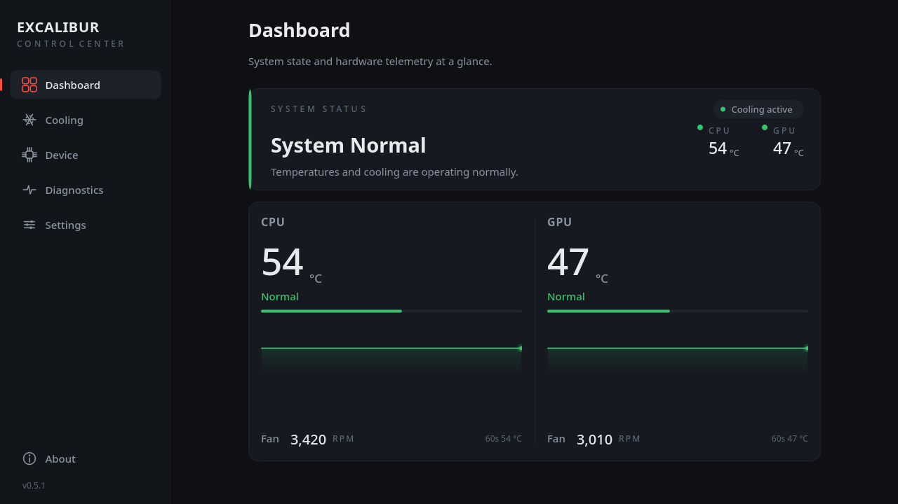
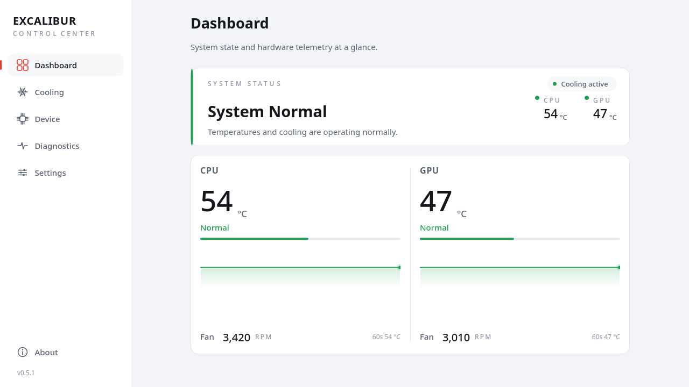
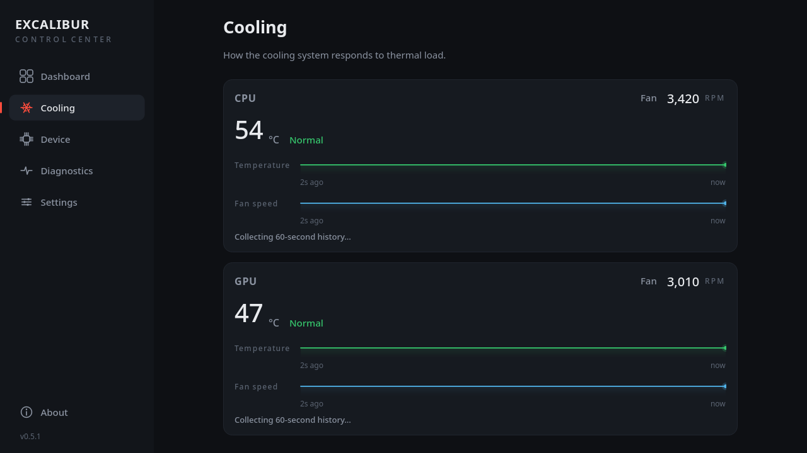
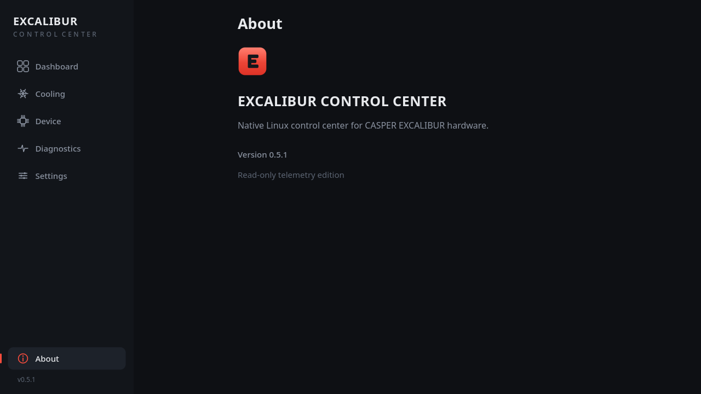

# EXCALIBUR Control Center

Native Linux hardware telemetry control center for CASPER EXCALIBUR laptops.

[](https://github.com/msahhf/excalibur-control-center/releases/latest)
[](https://github.com/msahhf/excalibur-control-center/actions/workflows/ci.yml)
[](LICENSE)
[](https://github.com/msahhf/excalibur-control-center)



---

## Introduction

EXCALIBUR Control Center is a native Linux desktop application for monitoring CASPER
EXCALIBUR hardware. It provides real-time thermal and fan telemetry, system
information, diagnostics, configurable display preferences, and background operation
through the system tray.

The application is built with **Qt6** and runs entirely as an unprivileged user. The
integrated **`excalibur-wmi`** driver is a read-only hwmon kernel module delivered
through **DKMS**, so it is rebuilt automatically for each installed kernel.

## Features

| Area          | Capabilities                                                        |
| ------------- | ------------------------------------------------------------------- |
| Telemetry     | CPU / GPU temperature, CPU / GPU fan RPM                            |
| History       | 60-second temperature and fan history                               |
| Dashboard     | Live system state and thermal overview                              |
| Cooling       | Per-channel temperature, fan speed and history view                 |
| Device        | Hardware, firmware and kernel information                           |
| Diagnostics   | Runtime diagnostics and JSON export                                 |
| Settings      | Theme (System / Light / Dark), Celsius / Fahrenheit, refresh rate   |
| Background    | System tray, hide/show, single-instance runtime                     |
| Driver        | Integrated read-only `excalibur-wmi` DKMS module                    |

The current release focuses on read-only telemetry; hardware control features are
outside the current capability set.

## Screenshots

| Dashboard (dark) | Dashboard (light) |
| ---------------- | ----------------- |
|  |  |

| Cooling | About |
| ------- | ----- |
|  |  |

## Architecture

```
EXCALIBUR Control Center
        │
        ├── Qt6 GUI
        │
        ├── AppState / TelemetrySnapshot
        │
        ├── HwmonClient
        │
        └── excalibur-wmi   (read-only hwmon driver)
                │
              DKMS
```

The GUI reads from a single central telemetry state. Pages never access `sysfs`
directly — `HwmonClient` is the only telemetry read boundary — and the driver
exposes read-only hwmon telemetry.

## Installation

### Supported packages

| Distribution | Package | Driver (DKMS) |
| ------------ | ------- | ------------- |
| Arch Linux / CachyOS | `excalibur-control-center-<ver>-1-x86_64.pkg.tar.zst` | included in the same package |
| Debian 13 (trixie) | `excalibur-control-center_<ver>-1.deb13_amd64.deb` + `excalibur-control-center-dkms_<ver>-1.deb13_all.deb` | separate DKMS package |
| Ubuntu 24.04 LTS (noble) | `excalibur-control-center_<ver>-1.ubuntu24.04_amd64.deb` + `excalibur-control-center-dkms_<ver>-1.ubuntu24.04_all.deb` | separate DKMS package |
| Any glibc >= 2.35 desktop | `EXCALIBUR_Control_Center-x86_64.AppImage` | **not included** (GUI only) |
| Any distribution (driver source) | `excalibur-control-center-<ver>.tar.gz` | driver source only — build required |

The Debian 13 and Ubuntu 24.04 `.deb` packages are built against each
distribution's own Qt version (Debian 13: Qt 6.8; Ubuntu 24.04: Qt 6.4) and are
**not interchangeable** — always use the package built for your distribution.

### Arch Linux / CachyOS

The package provides **both the application and the integrated DKMS driver**.

```bash
sudo pacman -U excalibur-control-center-<ver>-1-x86_64.pkg.tar.zst
# remove:
sudo pacman -Rns excalibur-control-center
```

### Debian 13 / Ubuntu 24.04

Install both the GUI and the DKMS driver package (this pulls in `dkms`; kernel
headers for your running kernel must be installed for the module to build):

```bash
# Debian 13 (trixie):
sudo apt install ./excalibur-control-center_<ver>-1.deb13_amd64.deb ./excalibur-control-center-dkms_<ver>-1.deb13_all.deb
# Ubuntu 24.04 (noble):
sudo apt install ./excalibur-control-center_<ver>-1.ubuntu24.04_amd64.deb ./excalibur-control-center-dkms_<ver>-1.ubuntu24.04_all.deb
# remove:
sudo apt remove excalibur-control-center excalibur-control-center-dkms
```

The GUI package works without the driver (it shows `Telemetry Unavailable`); the
driver package is only useful once the module can be built for your kernel (see
[Compatibility](#compatibility)).

### AppImage (GUI only)

The AppImage bundles the Qt6 GUI and **does not** install the `excalibur-wmi`
DKMS driver, never needs root and never writes outside itself. Live telemetry
therefore requires the driver to be installed with a native package.

```bash
chmod +x EXCALIBUR_Control_Center-x86_64.AppImage
./EXCALIBUR_Control_Center-x86_64.AppImage
```

### Build from source

Requirements: Qt6 Widgets, CMake, Ninja, and a C++17 compiler.

```bash
cmake -S gui -B gui/build -G Ninja -DCMAKE_BUILD_TYPE=Release
cmake --build gui/build
./gui/build/excalibur-control-center
```

The application starts without the driver and reports `Telemetry Unavailable` until
the module is available.

## Driver

The `excalibur-wmi` kernel module is packaged with the application on Arch and as
a separate DKMS package on Debian/Ubuntu; it is built through DKMS for the
installed kernel.

```bash
dkms status
sudo modprobe excalibur_wmi
cat /sys/class/hwmon/hwmon*/name     # excalibur_g870
```

### No telemetry? (`Telemetry Unavailable`)

If the dashboard shows **Telemetry Unavailable / Waiting for hardware**, the
driver is not providing the `excalibur_g870` hwmon device. Check, in order:

1. `dkms status` — is `excalibur-wmi/<version>` built and installed for your
   running kernel? The module only builds on kernels that provide the
   `wmidev_set_block` / `wmidev_query_block` API (see below).
2. Kernel headers for the running kernel must be installed for DKMS to build.
3. `modprobe excalibur_wmi` and `dmesg | grep -i excalibur` for probe errors.
4. On non-EXCALIBUR G870 hardware (or a VM) the device is simply absent; the GUI
   is working correctly and will show `Unavailable`.

## Hardware

```
CASPER EXCALIBUR G870 / NLXB 001
```

## Compatibility

| Kernel                 | Status                             |
| ---------------------- | ---------------------------------- |
| CachyOS `7.2.x`        | Verified (real hardware)           |
| `6.18.x-lts`           | Driver API incompatibility (not built) |

The driver targets the `wmidev_set_block` / `wmidev_query_block` kernel API. That
API is not present in the 6.18 LTS kernel, so the module does not build there
(DKMS skips it via `BUILD_EXCLUSIVE_KERNEL_MIN="7.2"`).

## Known limitations

- **Read-only.** There is no fan, RGB, power or performance-mode control.
- **Hardware.** Telemetry is specific to the CASPER EXCALIBUR G870 (NLXB 001)
  WMI interface; other machines show `Telemetry Unavailable`.
- **Kernel API.** The driver requires the 7.2.x WMI API; older/other kernels do
  not build it. Only the 7.2.x path has been verified against real hardware.
- **Fedora.** An RPM recipe exists but is **not** published/supported: its
  install/launch lifecycle has only been exercised in a container, never in a
  verified Fedora VM.
- **AppImage.** Verified as a GUI-only single file on a real KDE/Wayland desktop
  (launches and renders; Qt uses software rendering there because EGL is not
  available in that session) as well as under offscreen/X11 and an isolated
  headless Wayland compositor. It does **not** install the DKMS driver.
- **Secure Boot.** The packages neither generate keys nor sign modules; module
  signing is the user's responsibility.

## Telemetry

Telemetry values are displayed from the underlying hwmon readings without smoothing,
averaging or arbitrary clamping. What the hardware reports is what the application
shows. Physically implausible readings (outside sane bounds) are reported as
unavailable rather than displayed as real.

## Diagnostics

The Diagnostics view presents the application's runtime state and can export it as
JSON. Exported temperatures are canonical Celsius values; unavailable readings are
represented honestly rather than as invented numbers. The export contains no
environment variables, credentials or personal data — it is safe to attach to a
bug report. It includes the OS/kernel/desktop identifiers, the Qt and application
versions, the hwmon device path and the recent temperature/fan history.

## Status

```
Current release : v0.5.6
Stage           : Public release / active development
Platform        : Linux
Primary target  : CachyOS / Arch Linux
Also packaged   : Debian 13, Ubuntu 24.04, AppImage (GUI only)
License         : GPL-2.0-only
```

> AUR publication is pending account registration availability.

## License

GPL-2.0-only. See [LICENSE](LICENSE).

## Author

Muhammedşah Fidan — [@msahhf](https://github.com/msahhf)
